<div align="center">

# UNO Party

**把友情放进弃牌堆。**

一个为多人在线派对而生的 UNO 游戏服务 —— 纯函数规则引擎、毫秒级实时对战、断线无缝恢复座位。

[](LICENSE)
[](https://nodejs.org)
[](https://react.dev)
[](https://socket.io)
[](#-测试)
[](https://github.com/Qiu-LingYan/uno-game/pulls)

<br>

[在线试玩](https://uno.qiulingyan.top) · [快速开始](#-快速开始) · [架构](#-架构) · [部署](#-生产部署) · [报告问题](https://github.com/Qiu-LingYan/uno-game/issues)

</div>

---

## 核心特性

UNO Party 是一个完整的在线 UNO 对战平台：纯函数规则引擎保证每一局判定一致且可独立单测，Socket.IO 提供毫秒级的房间状态广播，SQLite 让整个服务零运维、可跑在小到 64MB 堆上限的进程里。

- **完整规则引擎** — 变色、跳过、反转、+2/+4、可叠加惩罚（+2 叠 +2、+4 见 +2 就加）、摸到能出就继续出、抓 UNO 惩罚、二人局反转等价跳过（官方规则）、胜利判定，全部由不碰 IO 与时钟的纯函数引擎驱动，24 项单测覆盖。
- **60 秒回合计时** — 轮到真人自动开始倒计时（剩 15 秒变红警示），超时自动出牌 / 摸牌并向全房间播报；机器人回合不占倒计时，1–3 秒随机节奏出牌。
- **机器人补位** — 人不够可在大厅一键添加 / 移除机器人（最多 7 座），与真人走同一规则引擎与计时器；抓 UNO 与喊 UNO 均为延迟概率行为，给真人留出真实反应窗口。
- **战绩与排行榜** — 公开胜率榜（大厅免登录可查）、个人中心最近 10 局对局记录、独立战绩存档；机器人不污染榜单。
- **毫秒级实时对战** — Socket.IO 房间广播，2–7 人同场竞技，掉线重连无缝恢复座位。
- **断线无忧** — 房间码写入 URL、断线 1 小时宽限、匿名玩家凭客户端指纹恢复座位——刷新页面照样回到牌桌，且旧 socket id 会被重绑定到新连接，手牌与回合状态不丢失。
- **旁观席机制** — 对局进行中加入自动入座观战席，本轮结束未满员即刻转正上场；同账号跨房间重复占座会被拦截。
- **民主踢人** — 一键发起 votekick，3 分钟倒计时，被踢者回线自动取消，掉线玩家也可被投票移出。
- **UNO！突脸时刻** — 任何玩家只剩一张牌时全房间共享 2.2 秒高光动画，随后开启 15 秒抓 UNO 窗口，手慢有罚。
- **局末结算浮层** — 一局打完直接留在牌桌：浮层展示每家剩牌数、对局用时、喊 UNO 次数，房主（或房主掉线 / 机器人时任意在场玩家）一键开下一局，旁观席自动转正。
- **动画质感** — 出牌从手牌飞向弃牌堆、摸牌时牌背从牌堆飞入手牌、开局发牌依次入场、hover 上浮、结算弹窗弹入，均遵循 `prefers-reduced-motion` 降级。
- **PWA 可安装** — manifest + 图标 + Service Worker（静态资源缓存优先、API 与 WebSocket 直连），手机加到主屏即开即玩。
- **账号与战绩系统** — 独立登录页（`#/login` 路由，与游戏主页分离，登录后自动回到原页面）、邮箱验证码注册（登录失败限速防暴力破解）、全局唯一 username、个人中心展示胜率 / 胜场 / 总场次 / 累计游玩时长。
- **移动端优先** — richup.io 风格设计：Nunito 字体、深紫夜色、霓虹发光；触控目标放大、手牌横向滑动吸附。
- **轻量部署** — SQLite 零运维存储，全栈单进程，一台 2GB 小鸡即可 hosting 一整个派对。

## 架构

```mermaid
flowchart LR
    subgraph client["客户端"]
        SPA["React 19 SPA<br/>Vite · richup.io 风格<br/>单文件 main.jsx"]
    end

    subgraph server["Node.js 服务端（单进程）"]
        IO["Socket.IO 4<br/>房间广播 · 座位恢复<br/>votekick · 房间 TTL 清扫"]
        ENGINE["纯函数规则引擎<br/>不碰 IO · 不碰时钟"]
        MAIL["Resend 邮件<br/>验证码注册"]
    end

    DB[("SQLite<br/>账号 · 会话 · 战绩")]

    SPA -- "Socket.IO / REST" --> IO
    IO --> ENGINE
    IO --> MAIL
    IO --> DB

    style client fill:#1a1526,stroke:#6647e0,color:#e6e0ff
    style server fill:#1a1526,stroke:#6647e0,color:#e6e0ff
    style SPA fill:#241c3a,stroke:#6647e0
    style IO fill:#241c3a,stroke:#6647e0
    style ENGINE fill:#241c3a,stroke:#6647e0
    style MAIL fill:#241c3a,stroke:#6647e0
    style DB fill:#241c3a,stroke:#00b8a9
```



**模块职责**

| 模块 | 职责 |
|---|---|
| `server/game.js` | 纯函数 UNO 规则引擎：不碰 IO、不碰时钟（时间由外部注入），可独立单测 |
| `server/index.js` | Socket.IO 房间生命周期：座位恢复、旁观席转正、votekick 计时、回合计时与机器人调度、房间 TTL 清扫 |
| `server/store.js` | SQLite 持久层：账号、会话 token、对局战绩 |
| `src/main.jsx` | 单文件 React 前端：错误 toast、UNO 突脸、变色 modal、飞牌动画、结算浮层、旁观/踢人 UI |

## 快速开始

```sh
git clone https://github.com/Qiu-LingYan/uno-game.git
cd uno-game
npm install
npm start        # 服务端监听 127.0.0.1:3001
npm run dev      # Vite 开发服务器（/socket.io/ 自动代理）
```

打开浏览器，输入昵称，创建房间（最多 7 人），把链接甩给朋友即可开局。想保存战绩？点右上角或面板底部的「登录 / 注册」进入独立登录页，游客可随时注册，登录后自动回到牌桌。

<details>
<summary><b>启用邮箱注册</b> · 可选，不配置则无法注册账号</summary>
<br>

在被 git 忽略的 `.env.local` 中配置 [Resend](https://resend.com)：

```ini
RESEND_API_KEY=re_xxx          # API key 绝不提交到 git
RESEND_FROM_EMAIL=no@your.tld  # 须为 Resend 验证过的发件域名
RESEND_FROM_NAME=UNO Party
APP_URL=https://your.domain
```

验证码 10 分钟有效，最多校验 5 次。

</details>

## 测试

```sh
npm test        # 规则引擎 / 胜负 / UNO 宣告 / 注册登录 / SQLite 战绩（含 mock Resend 集成测试）
npm run smoke   # 双客户端加入同一房间并同步出牌、摸牌动作
```

## 生产部署

1. 仓库放至 `/opt/uno-game`，`npm ci` 后配置 `.env.local`，确保 `data/` 可写，`npm run build`
2. `pm2 start ecosystem.config.cjs && pm2 save` — 应用仅绑定 `127.0.0.1:3001`，**切勿将该端口暴露公网**
3. 参考 `deploy/nginx.conf` 配置反向代理与 TLS（示例文件，需替换域名并自行校验后 reload）
4. 健康检查：`curl http://127.0.0.1:3001/healthz`
5. 备份：SQLite 文件位于 `data/uno.sqlite`（连同 WAL/SHM）

## 贡献

欢迎 Issue 与 PR。提交前请确保：

```sh
npm test    # 24 项测试全部通过
```

## License

[MIT](LICENSE)
